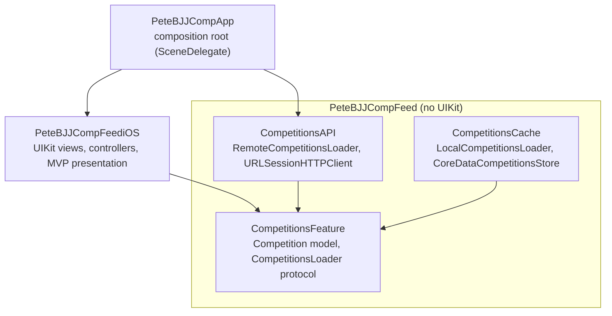

# BJJ Competition Finder for iOS

[](https://github.com/vincethecoder/app-bjj-competition-finder/actions/workflows/objective-c-xcode.yml)

An iOS app that lists upcoming Brazilian Jiu-Jitsu tournaments, built test-first with a modular Clean Architecture. The feature logic lives in a platform-agnostic framework, the UI lives in a separate iOS framework, and the app target only composes them, so either side can change without touching the other.

**83 tests** cover the domain, networking, Core Data cache, presentation and UI layers; there is more test code than production code.

## Screenshots

<!-- TODO: add 2–3 Simulator screenshots or a short GIF (feed, loading shimmer, error state) -->

## Features

- **Competitions feed** with per-cell image loading: a shimmer placeholder while loading and a fade-in when the image arrives (the mock API doesn't serve event images yet, so the app shows placeholders)
- **Pull to refresh**, plus an error banner when loading fails
- **Localized** in English, Portuguese (pt-BR) and Greek, with tests that fail if any localization key is missing
- **Core Data cache** with a 7-day max-age cache policy, validation and a versioned data model (fully tested; wiring into the app is next on the roadmap)

## Architecture



Arrows point toward the dependency. Everything depends on the `CompetitionsFeature` abstractions, and nothing in the core knows about UIKit.

Patterns worth a look:

| Concern | Where |
|---|---|
| Composition root | [`SceneDelegate.swift`](PeteBJJCompApp/PeteBJJCompApp/SceneDelegate.swift) wires concrete loaders into the UI |
| UI composition | [`CompetitionsUIComposer`](PeteBJJCompFeed/PeteBJJCompFeediOS/Feed%20UI/Composers/CompetitionsUIComposer.swift) builds the feed from presenters and adapters |
| Threading kept out of the UI | [`MainQueueDispatchDecorator`](PeteBJJCompFeed/PeteBJJCompFeediOS/Feed%20UI/Composers/MainQueueDispatchDecorator.swift) |
| Breaking retain cycles | [`WeakRefVirtualProxy`](PeteBJJCompFeed/PeteBJJCompFeediOS/Feed%20UI/Composers/WeakRefVirtualProxy.swift) |
| Cache rules isolated from storage | [`CompetitionsCachePolicy`](PeteBJJCompFeed/PeteBJJCompFeed/CompetitionsCache/CompetitionsCachePolicy.swift) |

## Requirements

- Xcode 15.4 or later
- iOS 17.5 or later (the `PeteBJJCompFeed` framework also builds for macOS 14.4)

## Running the app

```bash
git clone https://github.com/vincethecoder/app-bjj-competition-finder.git
cd app-bjj-competition-finder
open PeteBJJCompApp/PeteBJJCompApp.xcworkspace
```

Select the `PeteBJJCompApp` scheme and an iPhone simulator, then run. The app loads its data from a [mock JSON API hosted as a gist](https://gist.github.com/vincethecoder/6cd8e98604d3e5587be79c7f7a4ff3e4).

## Running the tests

Run these from the `PeteBJJCompFeed` directory, pointing `DEST` at any installed iPhone simulator:

```bash
cd PeteBJJCompFeed
DEST='platform=iOS Simulator,name=iPhone 17 Pro'
```

| Layer | Scheme | Tests | Command |
|---|---|---|---|
| Domain, API and cache use cases (unit) | `PeteBJJCompFeed` | 59 | `xcodebuild test -scheme PeteBJJCompFeed -destination "$DEST"` |
| Presentation, UI integration and localization | `PeteBJJCompFeediOS` | 20 | `xcodebuild test -scheme PeteBJJCompFeediOS -destination "$DEST"` |
| Core Data cache integration | `PeteBJJCompFeedCacheIntegrationTests` | 2 | `xcodebuild test -scheme PeteBJJCompFeedCacheIntegrationTests -destination "$DEST"` |
| API end-to-end (live mock API and [hosted image fixture](fixtures/)) | `PeteBJJCompFeedAPIEndToEndTests` | 2 | `xcodebuild test -scheme PeteBJJCompFeedAPIEndToEndTests -destination "$DEST"` |

The core schemes (`PeteBJJCompFeed` and `PeteBJJCompFeedCacheIntegrationTests`) also run on the Mac with `-destination 'platform=macOS'`.

The same suites run in [GitHub Actions](.github/workflows/objective-c-xcode.yml) on every pull request, on the newest available iPhone simulator and on macOS.

The tests follow a few conventions: behavior-named test cases (`test_loadImageDataFromURL_deliversInvalidDataErrorOnNon200HTTPResponse`), a `makeSUT` factory in each suite, spies and `URLProtocolStub` instead of real networking, and `trackForMemoryLeaks` checks that fail a test if the system under test is never deallocated.

## Background

This project started from the case study in [Essential Developer's iOS Lead Essentials](https://iosleadessentials.com) program, where I earned the Blue Belt. I applied the program's approach to a new domain and extended it:

- **A new domain:** BJJ competitions with their own model (venue, dates, registration status, categories, ranking points) and a self-hosted mock API
- **Localization in three languages** (English, pt-BR, Greek), covered by localization tests
- **An iOS 17 fix:** `UIRefreshControl` stopped showing its spinner in tests on iOS 17+ deployment targets, which broke the refresh tests. I fixed it in [#5](https://github.com/vincethecoder/app-bjj-competition-finder/pull/5)
- **A versioned Core Data model** (`CompetitionsStore` → `CompetitionsStore2`)
- **The same feed built three ways:** MVC, then MVVM, then MVP, each refactor landed as its own PR so you can compare them in the history

Every change landed through a pull request. The [closed PRs](https://github.com/vincethecoder/app-bjj-competition-finder/pulls?q=is%3Apr+is%3Aclosed) read as a step-by-step build log.

## Roadmap

- [ ] **Offline-first:** use a remote loader that falls back to the cache, save remote results to the cache, and validate the cache in the background
- [ ] **SwiftUI UI module** on the same core, with async/await adapters over the existing loaders and new tests in Swift Testing
- [ ] Competition detail screen, filters (date, location), and favorites
