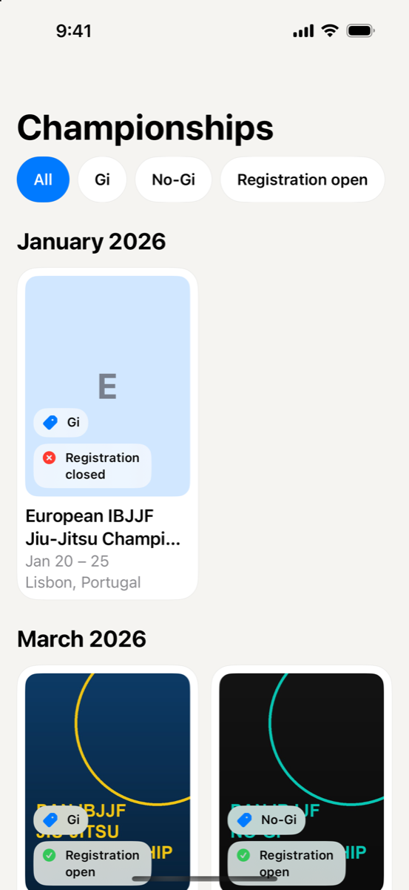
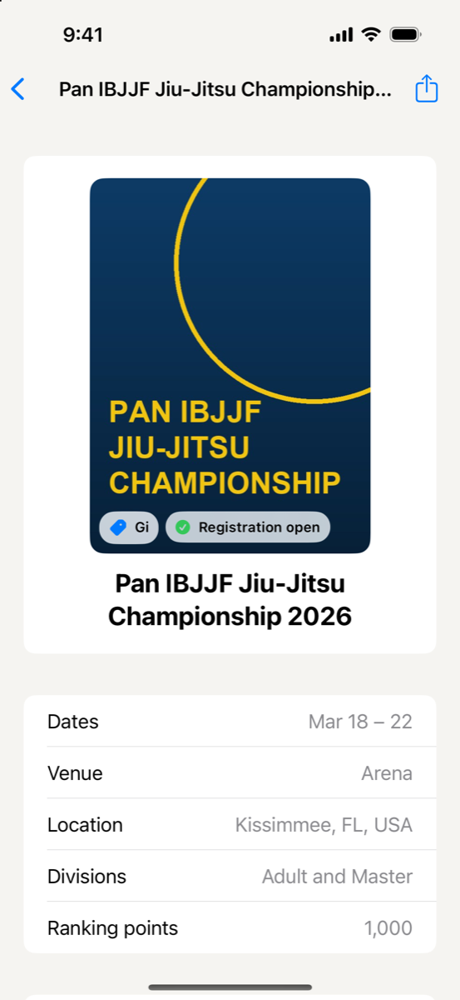
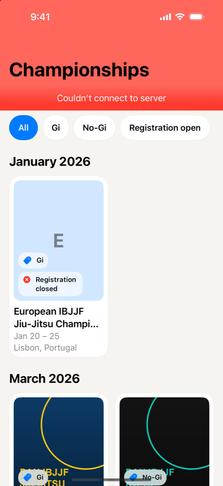
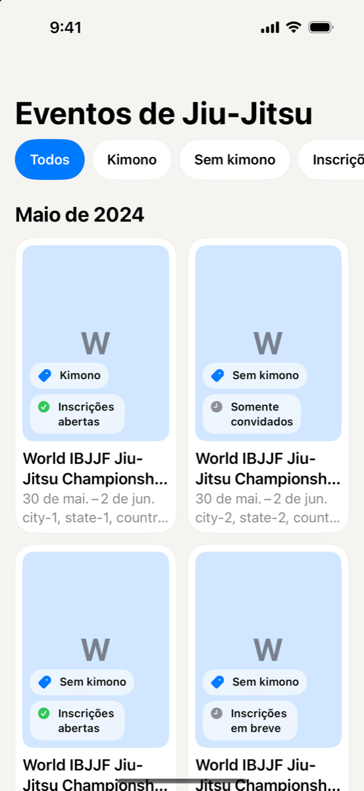
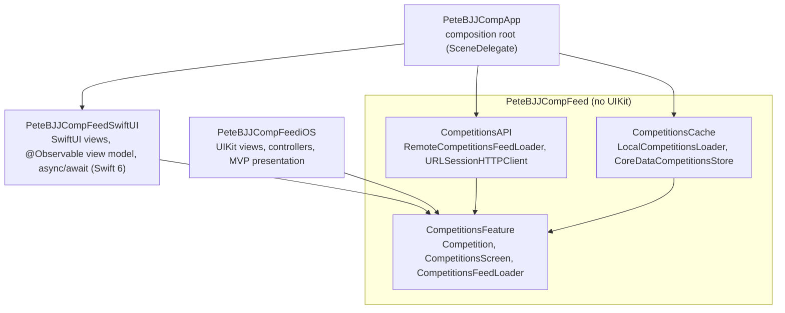

# BJJ Competition Finder for iOS

[](https://github.com/vincethecoder/app-bjj-competition-finder/actions/workflows/objective-c-xcode.yml)

An iOS app that lists upcoming Brazilian Jiu-Jitsu tournaments, built test-first with a modular Clean Architecture. The feature logic lives in a platform-agnostic framework, the UI lives in separate frameworks, and the app target only composes them, so either side can change without touching the other. The app runs on a server-driven SwiftUI poster grid; the original UIKit feed is kept as a second UI over the same core, and both are tested in CI.

**188 tests** cover the domain, networking, Core Data cache, presentation, both UIs and app composition; there is more test code than production code.

## Screenshots

| Server-driven grid | Event details | Offline, cached screen | Built on the device (pt-BR) |
|---|---|---|---|
|  |  |  |  |

## Features

- **Server-driven poster grid** in SwiftUI: the server's `screen` object picks the sections, order, filters, copy and badges from a closed set of components, and the app builds the same screen on the device when an older server or cache sends none
- **Event details:** venue, location, divisions, ranking points and notes, with links to register (only while registration is open) and to the event website, and a share button
- **Adaptive layout:** 2 columns on iPhone, 3 at regular width, 1 at the largest text sizes, from size classes and Dynamic Type rather than the screen width
- Pull to refresh, filter chips, a date and location menu that narrows the feed further, a `ContentUnavailableView` empty state, and a tappable error banner that VoiceOver announces; each card is one link that opens the event's details
- **Dynamic Type and dark mode** supported down to the largest accessibility text sizes
- **Localized** in English, Portuguese (pt-BR) and Greek, with tests that fail if any localization key is missing; requests send `Accept-Language` so server copy matches
- **Works offline:** the competitions and their screen load from the network and are saved together to a Core Data cache; with no connection, the app shows the cached screen with a banner explaining why
- **Core Data cache** with a 7-day max-age cache policy, a versioned data model (v3 adds the screen, with a migration test), and expired-cache cleanup whenever the app moves to the background

## Architecture



Arrows point toward the dependency. Everything depends on the `CompetitionsFeature` abstractions, and nothing in the core knows about UIKit or SwiftUI. The app composes the SwiftUI module; the UIKit module (`UI`) depends on the core the same way and could be swapped back in by changing one line in `SceneDelegate`.

Patterns worth a look:

| Concern | Where |
|---|---|
| Composition root | [`SceneDelegate.swift`](PeteBJJCompApp/PeteBJJCompApp/SceneDelegate.swift) wires concrete loaders into the UI |
| Offline-first without touching the UI | [`CompetitionsFeedLoaderWithFallbackComposite`](PeteBJJCompApp/PeteBJJCompApp/CompetitionsFeedLoaderWithFallbackComposite.swift) (remote, then cache) and [`CompetitionsFeedLoaderCacheDecorator`](PeteBJJCompApp/PeteBJJCompApp/CompetitionsFeedLoaderCacheDecorator.swift) (saves remote results) |
| UI composition | [`CompetitionsUIComposer`](PeteBJJCompFeed/PeteBJJCompFeediOS/Feed%20UI/Composers/CompetitionsUIComposer.swift) builds the feed from presenters and adapters |
| Threading kept out of the UI | [`MainQueueDispatchDecorator`](PeteBJJCompFeed/PeteBJJCompFeediOS/Feed%20UI/Composers/MainQueueDispatchDecorator.swift) |
| Breaking retain cycles | [`WeakRefVirtualProxy`](PeteBJJCompFeed/PeteBJJCompFeediOS/Feed%20UI/Composers/WeakRefVirtualProxy.swift) |
| Bridging callbacks to async/await | [`CompetitionsFeedLoader+Async`](PeteBJJCompFeed/PeteBJJCompFeedSwiftUI/Async/CompetitionsFeedLoader+Async.swift) wraps the completion-based loader for the Swift 6 module |
| Server-driven UI with a device fallback | [`RemoteCompetitionsScreen`](PeteBJJCompFeed/PeteBJJCompFeed/CompetitionsAPI/RemoteCompetitionsScreen.swift) decodes leniently, skipping unknown components; [`PosterScreenMapper`](PeteBJJCompFeed/PeteBJJCompFeedSwiftUI/Presentation/PosterScreenMapper.swift) uses the server screen or builds one from the competitions |
| Testable SwiftUI state | [`CompetitionsGridViewModel`](PeteBJJCompFeed/PeteBJJCompFeedSwiftUI/Feed/CompetitionsGridViewModel.swift), an `@MainActor @Observable` view model tested without rendering views |
| Cache rules isolated from storage | [`CompetitionsCachePolicy`](PeteBJJCompFeed/PeteBJJCompFeed/CompetitionsCache/CompetitionsCachePolicy.swift) |

## Requirements

- Xcode 26 or later (it generates the symbols for the SwiftUI feed's string catalog)
- iOS 17.5 or later (the `PeteBJJCompFeed` framework also builds for macOS 14.4)

## Running the app

```bash
git clone https://github.com/vincethecoder/app-bjj-competition-finder.git
cd app-bjj-competition-finder
open PeteBJJCompApp/PeteBJJCompApp.xcworkspace
```

Select the `PeteBJJCompApp` scheme and an iPhone simulator, then run. The app loads its data from a [mock JSON API hosted as a gist](https://gist.github.com/vincethecoder/6cd8e98604d3e5587be79c7f7a4ff3e4). That payload has no `screen` yet, so the app builds the grid on the device. In debug builds, pass `-CompetitionsURL <url>` as a launch argument to load a different feed, such as a local file server with a `screen` object.

## Running the tests

Run the framework suites from the `PeteBJJCompFeed` directory, pointing `DEST` at any installed iPhone simulator:

```bash
cd PeteBJJCompFeed
DEST='platform=iOS Simulator,name=iPhone 17 Pro'
```

| Layer | Scheme | Tests | Command |
|---|---|---|---|
| Domain, API and cache use cases (unit) | `PeteBJJCompFeed` | 79 | `xcodebuild test -scheme PeteBJJCompFeed -destination "$DEST"` |
| SwiftUI view model, screen and detail mapping, date and location refinement, grid columns, async adapter and localization (Swift Testing) | `PeteBJJCompFeedSwiftUI` | 66 | `xcodebuild test -scheme PeteBJJCompFeedSwiftUI -destination "$DEST"` |
| UIKit presentation, UI integration and localization | `PeteBJJCompFeediOS` | 20 | `xcodebuild test -scheme PeteBJJCompFeediOS -destination "$DEST"` |
| Core Data cache integration | `PeteBJJCompFeedCacheIntegrationTests` | 1 | `xcodebuild test -scheme PeteBJJCompFeedCacheIntegrationTests -destination "$DEST"` |
| API end-to-end (live mock API and [hosted image fixture](fixtures/)) | `PeteBJJCompFeedAPIEndToEndTests` | 2 | `xcodebuild test -scheme PeteBJJCompFeedAPIEndToEndTests -destination "$DEST"` |

The app suite runs from the `PeteBJJCompApp` directory. It's written in Swift Testing and covers the offline-first composition, the `Accept-Language` header, plus acceptance tests that launch the composed app online (with and without a server screen), offline and in the background:

| Layer | Scheme | Tests | Command |
|---|---|---|---|
| App composition and acceptance (Swift Testing) | `PeteBJJCompApp` | 20 | `xcodebuild test -workspace PeteBJJCompApp.xcworkspace -scheme PeteBJJCompApp -destination "$DEST"` |

The core schemes (`PeteBJJCompFeed` and `PeteBJJCompFeedCacheIntegrationTests`) also run on the Mac with `-destination 'platform=macOS'`.

The same suites run in [GitHub Actions](.github/workflows/objective-c-xcode.yml) on every pull request, on the newest available iPhone simulator and on macOS.

The tests follow a few conventions: behavior-named test cases (`test_loadImageDataFromURL_deliversInvalidDataErrorOnNon200HTTPResponse`), a `makeSUT` factory in each suite, spies and `URLProtocolStub` instead of real networking, and memory-leak checks that fail a test if the system under test is never deallocated (`trackForMemoryLeaks` in XCTest, and a `MemoryLeakTracker` verified from the suite's `deinit` in Swift Testing). New suites are written in Swift Testing; the original suites stay in XCTest.

## Background

This project started from the case study in [Essential Developer's iOS Lead Essentials](https://iosleadessentials.com) program, where I earned the Blue Belt. I applied the program's approach to a new domain and extended it:

- **A new domain:** BJJ competitions with their own model (venue, dates, registration status, categories, ranking points) and a self-hosted mock API
- **Localization in three languages** (English, pt-BR, Greek), covered by localization tests
- **An iOS 17 fix:** `UIRefreshControl` stopped showing its spinner in tests on iOS 17+ deployment targets, which broke the refresh tests. I fixed it in [#5](https://github.com/vincethecoder/app-bjj-competition-finder/pull/5)
- **A versioned Core Data model** (`CompetitionsStore` → `CompetitionsStore2` → `CompetitionsStore3`)
- **The same feed built three ways:** MVC, then MVVM, then MVP, each refactor landed as its own PR so you can compare them in the history

Every change landed through a pull request. The [closed PRs](https://github.com/vincethecoder/app-bjj-competition-finder/pulls?q=is%3Apr+is%3Aclosed) read as a step-by-step build log.

## Roadmap

- [x] **Offline-first:** use a remote loader that falls back to the cache, save remote results to the cache, and validate the cache in the background
- [x] **SwiftUI UI module** on the same core, with async/await adapters over the existing loaders and new tests in Swift Testing
- [x] **Server-driven poster grid** with filters, a device-built fallback, and the screen cached for offline use
- [x] **Competition detail screen** with the facts the card has no room for, registration and event links, and sharing
- [x] **Date and location filters:** this month or the next three months, and any country with an event, on top of the server's filter chips
- [ ] Favorites
